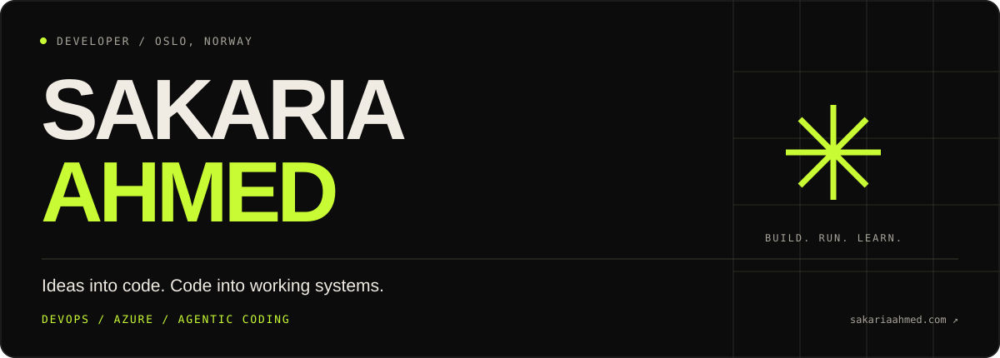

  
  
  

### Software is the starting point. Running it is part of the craft.

I'm **Sakaria**, a developer in Oslo with a strong interest in **DevOps, Azure and agentic coding**. I enjoy connecting application development, applied AI and infrastructure — building something useful, understanding how it works, and learning how to keep it running.

- **Building & operating:** an interactive MNIST app on my Linux homelab, with Terraform-managed Docker services and private monitoring.
- **Learning:** Azure administration through **AZ-104 study**, alongside hands-on Terraform and Linux work. I’m preparing for the exam.
- **Agentic coding:** experienced in using AI coding agents for planning, implementation, debugging and review, with tests and verification of their output.

### 01 / Selected work

<table>
<tr>
<td width="50%" valign="top">
<h3>✳ A drawing becomes a prediction.</h3>

<strong>MNIST digit recognition</strong>

Draw a number, inspect its 28 × 28 pixel input, and compare a neural network's scores. A TensorFlow CNN served by FastAPI, running on my own Linux homelab.

PYTHON · TENSORFLOW · FASTAPI · DOCKER

<a href="https://linux-lab.tail15c91a.ts.net/"><strong>Try the app ↗</strong></a> &nbsp; <a href="https://github.com/SakariaAhmed/Neural-Network-MNIST">Read the code</a>

</td>
<td width="50%" valign="top">
<h3>↗ A small server. A lot of learning.</h3>

<strong>Linux homelab</strong>

An Ubuntu virtual machine where I practise deployment, monitoring and recovery. Infrastructure in code, private dashboards, tested release rollbacks and backup restoration.

LINUX · TERRAFORM · DOCKER · PROMETHEUS · GRAFANA

<a href="https://github.com/SakariaAhmed/Linux-Homelab"><strong>Explore the lab ↗</strong></a>

</td>
</tr>
</table>

The MNIST demo runs on a personal homelab and may occasionally be offline.

**More builds:** [PricePulse](https://github.com/SakariaAhmed/PricePulse) — an Android electricity-price app · [QR Studio](https://github.com/SakariaAhmed/QR-generator) — a local-first QR workspace · [Portfolio](https://github.com/SakariaAhmed/Portfolio) — the website behind this profile.

### 02 / My toolkit

**Applications & AI**

    

**Infrastructure & operations**

    

**Currently studying**

### 03 / What I'm exploring next

Reproducible deployments. Better observability. Azure administration. Agentic development workflows that make the code easier to build, test and maintain.

---

<strong>Build something. Understand it. Make it better.</strong>  <a href="https://sakariaahmed.com/">Portfolio</a> · <a href="https://www.linkedin.com/in/sakaria-ahmed-02a801184/">LinkedIn</a> · <a href="mailto:sakariaahmed.code@gmail.com">Get in touch</a>

Profile foundation generated with <a href="https://gprm.itsvg.in/">GPRM</a>, then customised to match my portfolio.
<!-- Proudly created with GPRM ( https://gprm.itsvg.in ) -->
